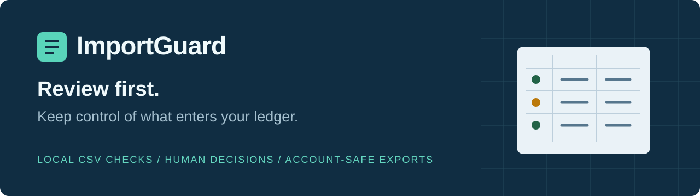

<p align="center"></p>

<p align="center">
  <a href="#quick-start"></a>
  <a href="#how-your-data-is-handled"></a>
  <a href="LICENSE"></a>
</p>

<p align="center"><b>Review first. Import with a record of every decision.</b><br>Local CSV overlap checks, human decisions, and exports separated by account and currency.</p>

<p align="center"><a href="#quick-start">Quick start</a> · <a href="#what-you-get">Features</a> · <a href="docs/actual-budget.md">Actual Budget findings</a> · <a href="README.zh-CN.md">简体中文</a></p>


<p align="center"><sub>Edited steps from actual UI operations using the included synthetic CSVs. The current interface is in Simplified Chinese. <a href="docs/assets/demo.mp4">MP4 version</a> · <a href="docs/assets/review.png">Full-size screenshot</a></sub></p>

> [!IMPORTANT]
> **The destination app makes its own import decisions.** In Actual Budget 26.10.0, two ID-less purchases with the same date, amount and payee, imported in separate batches, resulted in only one saved transaction in our isolated API tests—even when the second was explicitly included in ImportGuard. Stable-ID cases passed only with an explicit API `imported_id` mapping. The GUI mapping workflow was not tested. [Read the exact scope and results.](docs/actual-budget.md)

## Why ImportGuard?

Two statement downloads overlap. A coffee purchase looks like another coffee purchase. One account uses USD and another uses GBP. Before handing those rows to a ledger, you need to see which decisions are obvious and which need your attention.

ImportGuard compares an **existing ledger CSV** with an **incoming statement CSV**. It explains the candidates, lets you include or exclude each row, and produces a review bundle. It does not connect to a bank or modify your ledger.

## Quick start

Requires **Python 3.10+** and a browser. No `pip install`, account, API key, or cloud service is needed.

```sh
git clone https://github.com/Throokie/importguard.git
cd importguard
python3 server.py
```

Open **http://127.0.0.1:8767** and click **用模拟账单试一遍** (“Try sample statements”). Press **Ctrl+C** in the terminal to stop.

On Windows, run `py server.py` or double-click `start.bat` if the Python launcher is installed. On Linux/macOS, `sh start.sh` is also available. Linux is the locally tested environment; the other launch paths have not been manually validated. If the port is busy, run `python3 server.py --port 8877` and open the printed address.

### A complete sample in one minute

1. Load the built-in samples: **6 existing** and **11 incoming** transactions.
2. Confirm the column mappings, date format, amount direction, account and currency. The sample uses a shared ID system; only confirm that option for your own files when it is true.
3. Click **检查导入重叠** (“Check overlaps”). The sample has **5 new, 1 duplicate, 4 to review, and 1 invalid** row.
4. Exclude source row 3. Include rows 6 and 7 to retain both same-day purchases. The selection becomes **7 included, 2 excluded, 2 pending**.
5. Click **下载复核包** (“Download review bundle”). Read `import-manifest.json` and use the separate account/currency files. Pending and invalid rows stay out of the import files.

The download contains **Main/USD**, **Travel/USD**, and **Main/GBP** groups. Review the destination's preview and final transaction counts before relying on the result.

## What you get

| Capability | Behavior |
| --- | --- |
| Explain overlapping rows | View the reason and matching historical candidates before deciding. |
| Conservative defaults | Ambiguous matches remain pending; equal dates and amounts do not automatically prove a duplicate. |
| Account and currency separation | Each import file contains one normalized account/currency combination. |
| Explicit parsing | Select date order, decimal mark, signed or split amounts, encoding and field mappings. |
| An audit trail | Keep input fingerprints, row decisions, original fields and export adjustments. |
| Browser UI and CLI | Review interactively or generate a bundle from explicit configuration. |

### How decisions work

| Input condition | Default |
| --- | --- |
| Confirmed shared ID system; IDs unique on both sides; date, amount, account and currency agree | Duplicate → exclude |
| Same ID with conflicting fields or repeated IDs | Review → pending |
| Same account/currency and amount within the chosen date window | Review → pending |
| Multiple same-date, same-amount, same-payee rows in one batch | Review → pending; preserve each row |
| No detected overlap risk | New → include |
| Invalid format | Invalid → cannot include until fixed |

If the existing-ledger CSV has invalid rows, the whole comparison is blocked: an incomplete history is unsafe to treat as a clean baseline. Candidate details display up to five matches per row while preserving the full candidate count.

## Inside the export

```text
importguard-review.zip
├── import-manifest.json
├── accounts/                         # multiple account/currency groups
│   ├── g001_<hash>_USD/
│   │   ├── ready_rows.csv
│   │   └── normalized_rows.csv
│   └── ...
├── all_selected_rows_REVIEW_ONLY.csv # mixed summary; review only
├── all_normalized_rows_REVIEW_ONLY.csv
├── review.csv
├── audit.json
└── README.txt
```

For a single group, `ready_rows.csv` and `normalized_rows.csv` appear at the root. For multiple groups, use the paths in the manifest and import each into its matching destination account. **Do not import the `REVIEW_ONLY` mixed summary into one account.**

`ready_rows.csv` preserves the incoming column order and original fields, with formula-like text escaped. `normalized_rows.csv` is an alternative format with ISO dates, signed dot-decimal amounts and standard column names. **Choose one format; do not import both.** The manifest records account aliases, currency, row count, total and original source lines. See the [export reference](docs/export-format.md).

## How your data is handled

- CSV contents are sent from your browser to a Python process on **your own machine**, over loopback. This is a local client/server app.
- The server binds to `127.0.0.1`, processes uploads in memory, and does not save uploaded CSVs or log transactions. Your downloaded review ZIP contains the selected data and audit information.
- No analytics, external fonts, bank integrations, model calls, or third-party JavaScript are loaded by the application. The badges on this GitHub README are separate external images.
- Refreshing or closing the page loses the current selection. There is no saved-session restore feature.
- Formula-like text is escaped for spreadsheet safety, so some exported text fields can differ from the source. The audit retains the original values.

**Keep this service on loopback.** It is not a public hosting or multi-user deployment. These are implementation boundaries, not an independent security audit.

## Formats and limits

- CSV with headers; up to **5 MiB, 20,000 rows, 100 columns per file**.
- UTF-8 / UTF-8 BOM; Windows-1252 when explicitly selected. GBK/GB18030, XLSX and PDF are not supported.
- Explicit date formats: `YYYY-MM-DD`, `DD/MM/YYYY`, `MM/DD/YYYY`, `DD.MM.YYYY`; no timestamps.
- Signed single-column amounts, or nonnegative debit/credit columns. Decimal point or comma, strict thousands grouping, parentheses for negatives; up to 8 decimal places. No scientific notation or currency symbols in amount fields.
- Missing account/currency columns require explicit defaults. Names normalize case and whitespace; punctuation remains significant. Give genuinely different accounts distinct names.
- Only the history you provide can be checked. Split/combined transactions, foreign-exchange matching, bank synchronization, OCR and direct ledger updates are outside scope.

## Command line

```sh
python3 importguard.py \
  --existing examples/existing.csv \
  --incoming examples/incoming.csv \
  --config examples/config.json \
  --output review.zip
```

The CLI refuses to overwrite an existing ZIP. Configuration contains field mappings, date/amount settings, default context, matching options and row decisions. Decision keys are source line numbers as strings; a quoted multiline CSV record uses its ending physical line. See [`examples/config.json`](examples/config.json).

## Development

```sh
python3 -m unittest discover -s tests -v
```

Tests use synthetic data. The publication candidate passed **62 local synthetic-data tests** on Linux / Python 3.14.8. It has locally exercised Python logic, HTTP boundaries, account-separated exports, browser decisions and a real browser download. This is **an early-stage tool**, without real-bank-format acceptance, customer validation or a compatibility guarantee. [Validation scope and known limits](docs/validation.md) distinguish local checks from the partial Actual Budget tests.

Bug reports and improvements are welcome. Please read [CONTRIBUTING.md](CONTRIBUTING.md) and **replace all real financial information with synthetic examples**. The [roadmap](docs/roadmap.md) lists possible next steps without promising delivery dates.

## License

[MIT](LICENSE). ImportGuard is an independent project, with no affiliation or compatibility certification from Actual Budget, Sure, Firefly III or any bank. No code or media from the reference projects was copied.
