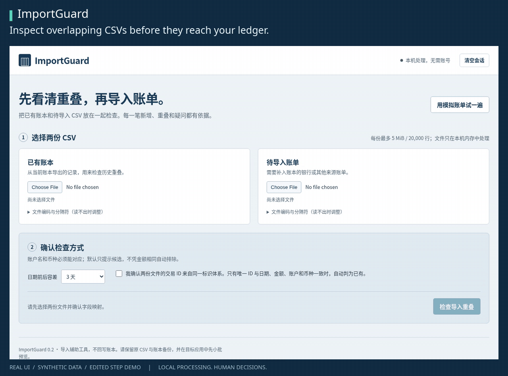

# ImportGuard

**先看清重叠，再导入账单。** 本机 CSV 导入前检查、逐笔人工决定、按账户与币种分文件导出。

[English](README.md) · [导出格式](docs/export-format.md) · [Actual验证范围](docs/actual-budget.md)



> **已确认限制：** Actual Budget 26.10.0中，无稳定ID、日期/金额/名称相同的两笔真实消费，分两次导入可能只保存一笔；ImportGuard人工选“加入”也不能保证目标新增。稳定ID案例只在本轮适配器显式映射API `imported_id` 时通过，完整GUI字段映射未验。导入前看目标预览，导入后核笔数与合计。

## 启动

需要Python 3.10+和浏览器，无需pip安装、账号、API密钥或云服务。

```sh
git clone https://github.com/Throokie/importguard.git
cd importguard
python3 server.py
```

打开 **http://127.0.0.1:8767**。按Ctrl+C停止。Windows可用`py server.py`或已有Python launcher时双击`start.bat`；Linux/macOS可用`sh start.sh`。本机实际验证为Linux，Windows/macOS启动入口未手工验收。端口被占用时用`python3 server.py --port 8877`，再打开打印出的地址。

## 一分钟试用

1. 点“用模拟账单试一遍”：6笔历史、11笔待导入。全部为合成数据。
2. 确认字段、日期、金额方向、账户与币种。演示来自同一ID体系；真实文件只有确实共享ID体系时才勾选确认。
3. 点“检查导入重叠”：5笔可新增、1笔已有、4笔待复核、1笔无效。
4. 第3行选“排除”；第6、7行都选“加入新增”，保留两笔真实消费。变成7加入、2排除、2待定。
5. 下载复核包。先读`import-manifest.json`，选择Main/USD、Travel/USD、Main/GBP各自文件，逐账户导入。待定和无效行不进入新增文件。

GIF由真实界面操作后截图剪辑而成，按步骤停留以方便阅读；不把它当连续实时速度展示。

## 决定与导出

同日同额不等于重复。只有确认相同ID体系、双侧ID唯一，且日期/金额/账户/币种都一致时默认判为已有；冲突或模糊候选保持待定。每一行可人工加入、排除或待定；格式无效不能强制加入。已有账本出现无效行会阻止检查，避免使用不完整历史。

单一账户/币种时，根目录提供`ready_rows.csv`与`normalized_rows.csv`两种格式，**只选一种导入**。多个组合时按组放进`accounts/`；根目录`all_*_REVIEW_ONLY.csv`只是混合复核汇总，不能导入单个账户。`review.csv`保留未加入行，`audit.json`记录输入指纹、决定、原文及公式防护修改。

危险公式样式文本会加单引号；合法有符号金额保留，原CSV不变，审计保留原值。因此导入预览时仍需核对文本。完整说明见[导出格式](docs/export-format.md)。

## 数据与边界

- 浏览器把CSV发给本机Python进程，只走`127.0.0.1`。上传内容只在内存处理，不写上传文件、不记交易日志。下载包包含交易内容，请自行保管。
- 不接银行、不调用外部模型、不加载外部字体或脚本、无统计追踪。GitHub README上的徽章是独立外部图片。
- 刷新/关闭页面会失去当前选择，没有恢复会话功能。只用于本机，不对公网或多人部署。
- 每份最多5 MiB、20,000行、100列；CSV必须有表头。支持UTF-8/BOM及明确选择的Windows-1252，不接GBK/GB18030、Excel或PDF。
- 日期顺序、小数分隔符、单列有符号金额或收入/支出双列均需确认；金额最多8位小数，不接科学计数法/货币符号/空金额。
- 缺账户/币种列时必须填默认值。账户名只归一大小写与空白；实际不同账户应使用可区分名称。
- 仅比较所提供历史范围；不支持拆分/组合匹配、跨币种换算、银行同步、OCR或直接改账本。未做独立安全审计、真实银行格式验收或客户验证。

本发布候选在Linux / Python 3.14.8下62项合成数据检查通过，包括12项可独立运行的分账户导出检查；不把本机通过等同于远端CI或完整目标兼容通过。

## 命令行与开发

```sh
python3 importguard.py --existing examples/existing.csv --incoming examples/incoming.csv --config examples/config.json --output review.zip
python3 -m unittest discover -s tests -v
```

不会覆盖已存在的输出ZIP。配置中`decisions`键为源物理行号字符串，值为`include`、`exclude`或`pending`；多行引号记录使用结束物理行号。

[贡献说明](CONTRIBUTING.md) · [已验证与未验证](docs/validation.md) · [路线图](docs/roadmap.md)

采用[MIT许可](LICENSE)。独立项目，不代表Actual、Sure、Firefly III或银行的合作/兼容认证。报告问题请只用脱敏合成样例。
